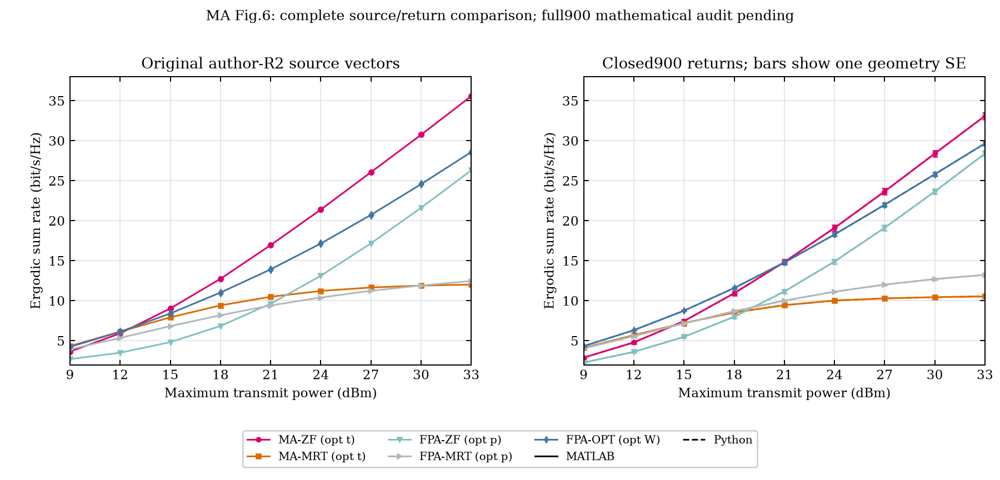

# MA Fig.6: all closed900 return curves versus the original R2 source

This packet compares every9:3:33dBm point of all five schemes, in both
languages, with the supplied author-R2 `P_6_4.eps`. Its exact SHA256 matches
the existing author-source catalog. The public [arXiv v2 manuscript](https://arxiv.org/html/2410.05912v2)
also identifies Fig.6 as the N6/M5/kappa6 power scan. Exact final-publisher
text/figure equivalence and the author's original random inputs remain
unverified. Original private EPS/TeX files and their rendered page are not
redistributed.

All900 actual native/Python return pairs and all4500 geometry/scheme table
rows were already checked in the [complete execution/return packet](../MA6-native900-execution-closure-20261017/README.md).
This reader freshly validates that compact packet, recalibrates all45 source
vector points, recomputes every complete100-geometry mean, and pairs all90
language/source comparisons without interpolation or gain/noise/geometry
fitting. The actual local run additionally rechecked the original EPS bytes
and every extracted vector path. The portable command uses the delivered
vectors and does not re-read those private EPS bytes.

| Scheme | Maximum stored-mean/source gap, bit/s/Hz |
| --- | ---: |
| MA-ZF |2.4759|
| MA-MRT |1.4737|
| FPA-ZF |2.0840|
| FPA-MRT |0.8047|
| FPA-OPT |1.2657|

All45 point gaps per language exceed one original EPS decimal ordinate step
(approximately0.00012287bit/s/Hz). That comparison describes vector rounding;
it is not a prespecified reproduction tolerance or a statistical rejection
of an unknown author ensemble. The complete unrounded differences are in
JSON/CSV. Author Monte Carlo counts, seed, initial positions, and Nr/Nc
factorization/orientation remain unrecovered.

The CSV also retains the sample standard deviation across all100 complete
geometry means and its standard error, SD/sqrt(100). The plot shows one such
SE, only for this supplied ensemble. These are not author uncertainty bars or
confidence intervals. The configured100 geometries and1000 NLoS draws per
geometry are explicitly reconstructed choices, not recovered paper counts.

An additional source qualification is local to the supplied R2 files. The
R2 prose at line933 limits the MA-ZF ranking exception to9dBm. At12dBm, its
own EPS instead gives MA-MRT6.1407372, FPA-OPT6.1298020 and MA-ZF5.9274403.
The MA-MRT/MA-ZF difference0.2132969 exceeds two EPS rounding steps. This is
a prose/figure ordering qualification in that supplied version, not a
numerical algorithm counterexample or a verified final-journal erratum.



The original nonzero2–38 vertical range is retained on the source panel.
All computed points and SE bars remain visible; the shared legend is outside
the data. Actual visual inspection and final image hashes are recorded.

With the repository requirements installed and a fresh destination:

```text
python tools/ma-native-replay/replay_reference_evidence.py --closed-packet strict/validation/MA6-native900-execution-closure-20261017 --packet strict/validation/MA6-closed900-original-reference-20261017 --output-dir new-MA6-source-replay
```

Eight new payloads and the preceding eight closure payloads are checked. All
4500 aggregate rows,45 original points per language,90 comparison/variability
rows and all nine scheme rankings replay exactly. The full4.5million RAW
sample comparison is not repeated by this compact command. The full900
independent received-signal/coordinate/FPA-W/KKT checks and original-reference
agreement remain incomplete; close language returns do not close those gates.
