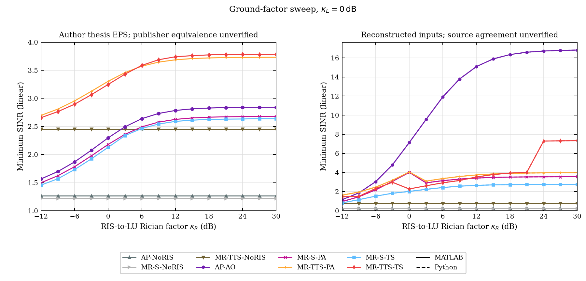
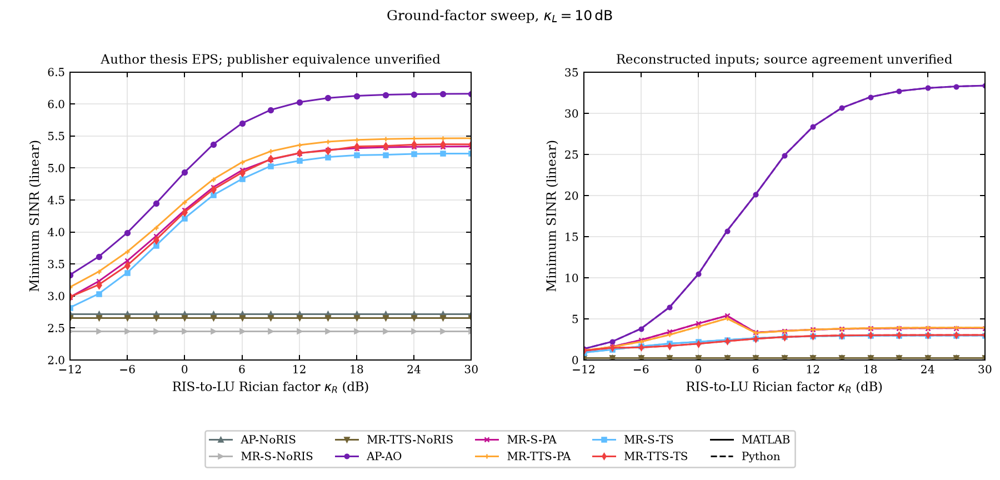
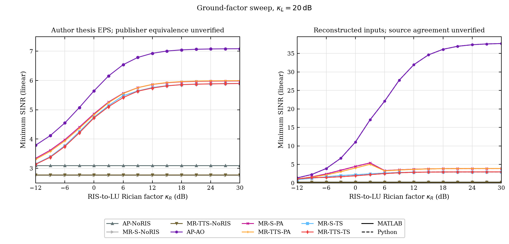

# Complete45 paired ground-factor source cases and720 actual final states

This packet retains the three original15-point scans, kappa_R=-12:3:30dB,
for kappa_L=0/10/20dB. Exact source ordinals are66..80,81..95 and96..110,
respectively. Both languages retain all eight schemes and the original
J3/U2/N16/M25 scenario,50W per satellite and saved GT limits. No original
slot or failed receipt is discarded and no new optimizer or random draw is
used to assemble this packet.

All720 actual final states and5760 physical scalar coordinates per precision
pass independent MP80/MP100 checks. Maximum precision difference is
1.62629177234672825095147665840942223992079456645237253027484511532760329746481548859102575219160579993631e-79. Every actual original numeric bound,
phase domain and final physical field is retained. Native phase/QT endpoint
and configured1000-draw moment receipts are bound individually for every
closed case. The full original phase/QT/MC RAW tapes remain external; this
compact packet does not repeat those absent historical trajectories.

The largest MATLAB/Python minimum-SINR difference is
0.0004205756878 linear, or
0.0008775055994dB. These are independently optimized
solutions; the same-state arithmetic tolerance is not relaxed into a claim
of identical nonconvex optima.

All360 original source ordinates per language are compared without fitting.
The original author-thesis EPS figure8/9/10 vertical ranges1–4,2–6.5 and
2.5–7.5 are preserved in the source-comparison panels. Maximum Python/source
linear-SINR gaps by panel are{'8': 13.971332235587266, '9': 27.221157710261316, '10': 30.58048042249348}. The fixed-input NoRIS relaxation identifies
{'python': 135, 'matlab': 135} above-bound
source ordinates out of135 per language. The reconstructed physical inputs
therefore still do not recover those source curves. Full geometry/gain/pattern
and publisher-source conformance remain unresolved; this is not proof of an
author-paper error under its unrecovered inputs.

All45 old Python input/return associations were freshly bound. Within each
15-point cohort only r_mean/r_var change; the five NoRIS coefficient arrays
and the saved NoRIS returns are exact invariants. Public replay also checks
that invariance separately in both languages. All prior66 source cases retain
exact original comparisons and MP NoRIS coefficients after the reader scope
extension. A missing original state is rejected before successful output.

The configured1000 moment draws are validation of channel moments, not1000
separately optimized performance experiments or recovered author MC counts.
Unreported reconstruction controls and old failures retain their declared
scope. Exact final-publisher equality of the author-thesis EPS is unverified.





The archive retains all9 original generated PNGs, their SVGs, data and actual
visual QA. The three displayed diagnostics preserve source scales and use
a separate nonnegative scale for computed curves so no reconstructed value
is clipped to the author's range. Their legend is outside the data.

Install the repository requirements and mpmath==1.4.1; use a fresh destination:

```text
python tools/cooperative-stable-replay/replay_ground45_evidence.py --packet strict/validation/cooperative-ground45-dual-final-states-20261017 --output-dir new-ground45-full-replay
```

The default command byte-verifies and restores every payload, recomputes all
720 final states at MP80/MP100, repeats the complete unfitted comparison and
NoRIS bound, and checks all plot-data associations. An already completed local
MP report can be reused only with the explicit
`--reuse-exact-local-final-report` option and matching complete input/current
math-source hashes. That reuse performs zero new final-physics evaluations;
it is reported explicitly. CI uses the default fresh recomputation.

This closes the selected45-case final-state scope. Full183 native execution,
all other source scenarios and full-paper/original-reference reproduction
remain incomplete. Private EPS/manuscripts are not redistributed.
