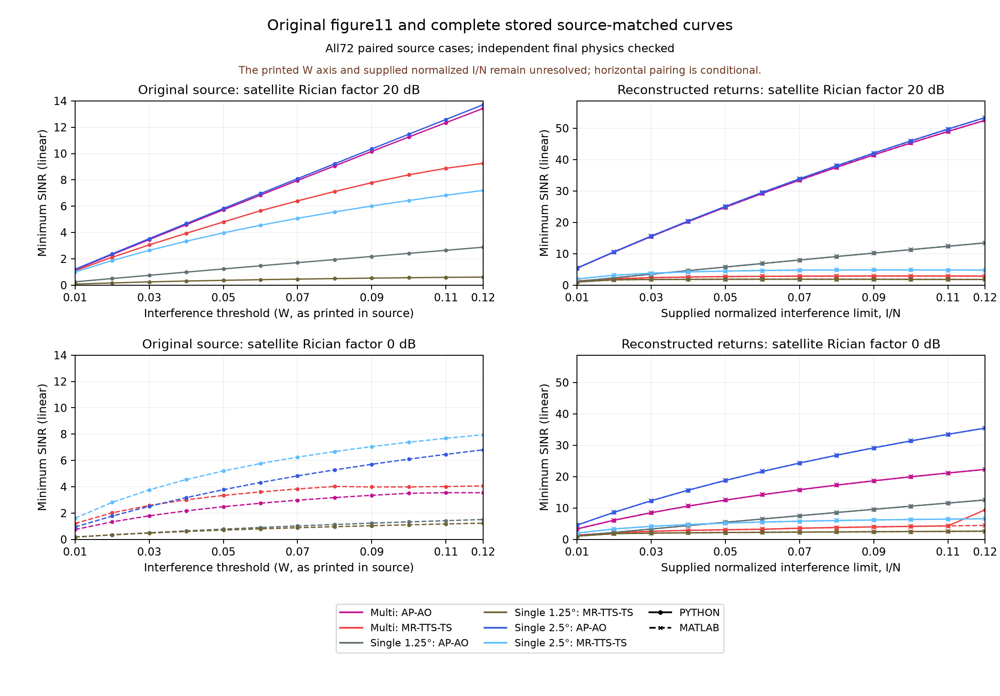

# Complete72 paired multi/single-satellite final states

This packet retains all original source-index slots111..182, eight actual final
schemes per case and both MATLAB/Python returns:1152 final physical states.
Independent80- and100-decimal-digit calculations pass all7680 scalar physical
fields per precision, unchanged power/interference bounds and phase domains.
The largest MP80/MP100 difference is4.541175343858841e-79.

Both full scenes retain48 total antennas and150W total power:

| Scene | Satellites J | Antennas per satellite N | Users | RIS elements | Satellite Rician factor |
| --- | --- | --- | --- | --- | --- |
| Multi | 3 | 16 | 2 | 25 | 0 or20dB |
| Single,1.25 degree offset | 1 | 48 | 2 | 25 | 0 or20dB |
| Single,2.5 degree offset | 1 | 48 | 2 | 25 | 0 or20dB |

Each of these six complete cohorts retains all12 original interference slots.
All11 physical arrays remain byte-identical within each language's pure
threshold scan. Native phase/QT/configured-moment receipts are bound for every
case; their full inner tapes are separate evidence and are not included here.
The configured1000-draw moment checks are not an author performance-MC count.

The original figure11 contains12 curves with12 ordinates each, so there are144
source ordinates per language. All288 reconstructed plotted ordinates across
both languages are traced to their actual saved scheme. The plot and comparison
retain every source point, the source0..14 vertical range and its original
path-coordinate calibration. No gain, abscissa, scaling or physical coefficient
is fitted to the source.



The printed source interference axis is W; the supplied implementation uses
normalized I/N. Their correspondence is unresolved. Horizontal pairing and the
reported maximum39.6634780357 linear-SINR source gap are conditional on that
unresolved convention. Optimized language results also differ: the maximum
absolute linear gap is4.9749274816 and the maximum dB gap is3.2647135850. A
same-state physical audit does not certify equality of independently optimized
solutions, source agreement, global optimality or full-paper reproduction.
Figure11 has no source NoRIS ordinates; none are invented for this packet.

MATLAB's single-satellite design transport omits the leading singleton axis.
The reader restores only the exact J=1,U=2,N=48 W(48,2) or p(2,) layout to its
logical shape. All384 affected arrays preserve their dtype and C-order bytes;
eight invalid-layout controls are rejected. The earlier reader exception and
nonzero audit exit remain preserved. The corrected full1152-state audit is a
new separately recorded successful step. Original values, optimizer settings,
RNG states and old native JSON are unchanged.

The archive has26 payloads,4097970 compressed bytes and eight512KiB-or-smaller
parts. SHA256:

```text
cfeb88c84ae22b4c42dcce916df00b6c66eca18d8384380ff6c6c6f8fddf1826
```

It includes the actual array bank, case/scheme index, both full curve views,
complete MP80/MP100 reference, original vector coordinates, all three actually
inspected PNGs, source-comparison SVG/data, source/configuration bindings and
the actual lossless-transport/visual-QA receipts. The private EPS and manuscript
are excluded. Each archive part and every payload has a byte/hash binding.

With repository requirements and mpmath installed, use a fresh destination:

```text
python -B tools/cooperative-stable-replay/replay_multi_single_evidence.py --packet strict/validation/cooperative-multi72-dual-final-states-20261017 --output-dir new-multi72-replay
```

Default replay freshly checks all1152 states at both precisions and recomputes
all144 source comparisons per language. The separate CI job uses that default.
The completed local public transport roundtrip explicitly reused the exact
complete report only after every restored input and current math-source hash
matched; it records zero new MP states. Original optimizers and production RNG
are never called by the replayer. Full inner/outer trajectories, original dual
certificates, author ensemble controls and source-conforming physical inputs
retain their separate unresolved gates.
