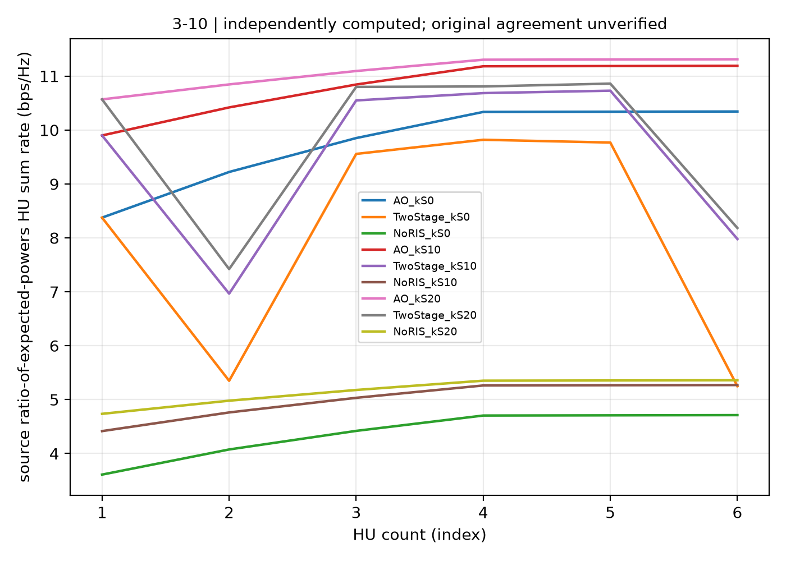

# Saved native statistical Fig3-10: actual endpoint and sample replay

**Original-reference agreement and complete paper reproduction remain false.**
This packet consumes the already completed standard native statistical bank;
it is not a new cold campaign or the separately prepared V3 typed-stream
full-inner-trajectory audit.

The full source dimensions are retained: 16 feeds/streams, 25 subpanels,
U=1..6 with K=16-U, and satellite Rician factors 0/10/20 dB. NoRIS, TwoStage
and AO each retain every prescribed start0..U, giving **243 actual starts**.
The branch remains explicitly labelled corrected vector-QT finite-Rician
statistics, not the source's invalid printed scalar QoS/SOC.

## Verified scope

- All 18 native source/configuration bindings matched the saved producer when
  its constructor was replayed. Complete complex arrays include explicit
  shapes and column-major order; no channel or variance is replaced by LoS.
- Every initial/final power and NHU QoS check passes its original1e-5 gates.
  All 641 recorded stopping fields retain their original gradient1e-6 or
  signed relative-improvement1e-4 rule. Every terminal phase gradient passes
  the separate cross-language Python check; its maximum is about9.999582e-7.
  Historical intermediate iterates are not independently replayed by this gate.
- All 243 final physical metric vectors were evaluated independently at both
  MP80 and MP100. All pass the pre-existing field policy absolute1e-9 plus
  relative1e-10. Maximum precision-lane difference is about1.677e-76, below
  absolute1e-40. This is a numerical reference comparison, not an interval proof.
- All **54000 actual native rate samples** were physically replayed using the
  saved fixed designs and each case's declared original1000-draw RNG stream.
  Maximum sample error is **2.460254222569347e-12**. The means, standard errors
  and empirical expected-power ratios also pass absolute1e-9. No optimization
  or reference-curve fitting occurs in these checks.

The stricter float64 absolute-only diagnostic remains available: **22 starts**
exceed its absolute1e-9 comparison, with maximum4.2264218791387975e-9.
That failed diagnostic is not overwritten or relabelled. At MP80/MP100,
maximum native-record/reference absolute difference is4.918691283299393e-9;
the largest fraction of the previously declared mixed field allowance is
0.021085332720448158. Physical constraints and stopping thresholds are unchanged.

## Original curves and dual-language evidence

All nine curves and54 points use the original ratio-of-expected-powers metric.
The separately replayed `E[log]` samples are not substituted into this plot.

The native and separately converged Python curves differ by at most
**0.00016574646957856487 bit/s/Hz**. The native curves still differ from the
retained original-EPS extraction by up to **8.008012959184224 bit/s/Hz**.
The original EPS source SHA remains
`fbcd024a896c49dcba58973df0bd42c06700f96911212ff3324ab9c846cfaa93`;
no fresh EPS read or final-publisher equivalence is claimed here.

A fresh read of the supplied author source also verifies a separate repeated
G-scatter coefficient contradiction. The [exact coefficient receipt](rician-source-coefficient-audit.json)
retains source SHA/line anchors and all7200 native constructor mean/variance
checks. The implementation already follows normalized Eq3-1. This error does
not explain the NoRIS curve discrepancy; its channel contains no G term.
The source explicitly defines50W as a total beam-power budget, excluding an
unreported per-feed rescaling as a remedy. See [the scoped erratum](../../hotspot-satcom/STATISTICAL_ERRATUM.md).

This reproducible discrepancy must be resolved against the supplied model,
normalization, geometry and pattern assumptions. It is not, by itself, a
universal publisher-error certificate. Original artwork and private manuscripts
are not redistributed.

## Reuse the actual numerical evidence

`native18-saved-inputs.tar.gz` is approximately4.9 MB. It contains the unchanged
18 native case files, their18 configuration files and the18 exported model
contexts. Native final/initial states, all starts and all54000 recorded sample
values remain present. Its lightweight bank index is explicitly a portable
file index, not a replacement native process receipt. The original producer
progress SHA and each case's original bytes are retained in provenance.

The approximately477 MB replayed channel payload remains an external runtime
output and can be regenerated with the MATLAB exporter. No solver binary,
credentials, private path or manuscript is included. See the [replay commands](../../../tools/hotspot-native-replay/README.md).

The endpoint, multiprecision, sample-replay and curve-comparison JSON files
retain separate scope flags. Complete historical inner trajectories, source
conventions, original-curve agreement and the rest of the paper remain open.
